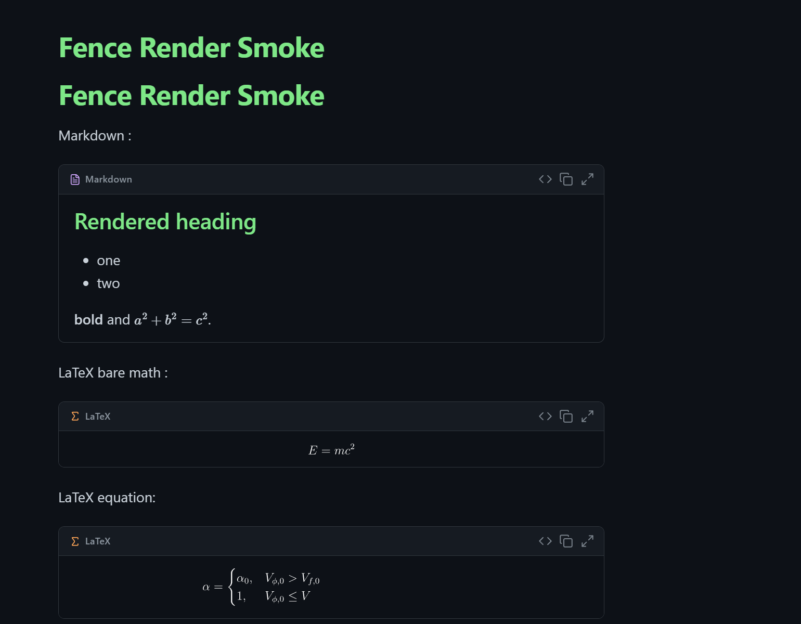

# Fence Render Utils

It's my small util plugin😄, I fully vibed this plugin for myself, free to use for all of you, have fun!

Render fenced code blocks as embedded previews inside Obsidian notes:

| Fence language | Preview |
| --- | --- |
| `md`, `markdown` | Rendered with Obsidian's Markdown renderer, including math and links |
| `latex`, `tex` | Compiled locally with LaTeX and shown as vector SVG |
| `html`, `htm` | Rendered in an isolated, sandboxed iframe |

`mermaid` fences are deliberately **not** touched. Mermaid already has a native
renderer, and this plugin only exists for the languages Obsidian does not render
by itself.



## Highlights

- **Works in Reading view and Live Preview.** In Live Preview the fence shows
  its rendered window when the cursor is outside the block, and returns to the
  normal editable source when the cursor enters it.
- **Per-format switches.** Markdown, LaTeX, and HTML can each be turned on or off
  from settings. Disabled formats fall back to a normal-looking code block.
- **Window controls.** Every preview has a toolbar with fold, source/preview,
  copy, and fullscreen buttons. Fold collapses a multi-line preview to its
  header; fullscreen opens a viewport-sized review window. The toolbar can be
  hidden in settings.
- **Outer-page scroll chaining.** When an inner preview reaches its scroll
  boundary, continued scrolling moves the note instead of stopping.
- **ChatGPT paste conversion.** Pasting into the editor converts `\(inline\)`
  to `$inline$` and `\[display\]` to a `$$` block equation, while leaving code
  untouched.
- **Adjustable LaTeX preview size and width.** Scale compiled LaTeX from 100% to
  400% and choose fit-content or full-width rendering.
- **Right-click any rendered equation** to copy it as a PNG image or copy its
  LaTeX source. This works for both fenced LaTeX previews and normal
  `$$…$$` / `$…$` Markdown equations.
- **Equation-environment copy.** Copied equation source is wrapped in
  `\begin{equation} … \end{equation}` by default, with a setting to turn this off.
- **Copy equation images** with a white background at high DPI, suitable for
  pasting into Word, PowerPoint, emails, or other notes.
- **Right-click any rendered Markdown table** to copy only that table as
  Markdown source or as a complete LaTeX `table`/`tabular` environment with
  bold, italics, code, links, escaped characters, and inline math converted.
- **LaTeX packages in settings.** Fences are assumed to be the body of a
  document, so `\usepackage` lines do not need to be repeated. Configure the
  packages and extra preamble once.
- **Dark-mode LaTeX inversion.** Compiled LaTeX is light-on-dark in dark themes by
  default. This can be disabled.
- **No Compilation of Mermaid.** No Mermaid processing is registered at all.

## Installation

This plugin is desktop-only because it calls a local TeX installation.

1. Copy `main.js`, `manifest.json`, and `styles.css` into:

   ```text
   <vault>/.obsidian/plugins/fence-render-utils/
   ```

2. Enable **Fence Render Utils** in **Settings → Community plugins**.
3. Open **Settings → Fence Render Utils** and check the LaTeX toolchain.

### LaTeX requirements

The plugin needs two executables:

- `latex` (MiKTeX, TeX Live, or another LaTeX distribution)
- `dvisvgm` (ships with MiKTeX and most TeX Live installations)

`pdftocairo` is optional but recommended. When present, it preserves display
tags such as `\tag{1.1}` better than dvisvgm. The plugin falls back to dvisvgm
automatically when `pdftocairo` is missing.

They must be on `PATH`, or their full paths must be entered in settings. MiKTeX
on Windows normally installs `latex`, `dvisvgm`, and `pdftocairo`. The **Test**
button in the settings checks that the required executables can be started.
Tested with Obsidian 1.15.1 and MiKTeX 26.5 on Windows.

The plugin does **not** enable shell escape. Missing MiKTeX packages can be
installed automatically when **Auto-install missing MiKTeX packages** is enabled;
TeX Live users can install packages with `tlmgr`.

## Usage

````markdown
```markdown
## This is rendered

A paragraph with **bold**, a list, and $a^2 + b^2 = c^2$.
```

```latex
E = mc^2
```

```html
<h2>Hello</h2>
<p>This is inside a sandboxed iframe.</p>
```
````

When the cursor is inside a fence in Live Preview, Obsidian shows the normal
editable source. Move the cursor outside the block to see the embedded preview.

### Pasting from ChatGPT

Pasting ChatGPT text into the editor converts the LaTeX delimiters ChatGPT uses
to Obsidian's delimiters:

- `\(inline math\)` → `$inline math$`
- `\[display math\]` → a `$$` display block

The conversion is enabled by default with **Convert ChatGPT math delimiters on
paste** in settings. It only touches pasted text; existing note content is not
rewritten. Fenced code blocks, inline code, and already-escaped `\\(` / `\\[`
delimiters are left unchanged. Pasting directly inside a code block is skipped.

### Copying rendered equations

Right-click a rendered equation to open:

- **Copy equation image** — copies a high-DPI PNG with a white background.
- **Copy LaTeX source** — copies the equation's TeX source inside
  `\begin{equation} … \end{equation}` by default.

The equation wrapper is controlled by **Wrap copied equations in an equation
environment** in settings and is on by default. Existing equation/align
environments, prose, tables, and full documents are left as they are. Turning it
off copies the raw source.

This works in Reading view and Live Preview. In Live Preview, the items are added
to Obsidian's normal editor context menu, so the usual editor actions stay
available. In Reading view, a small dedicated menu is shown.

For a fenced LaTeX preview, right-click anywhere on the preview (the equation or
its paper background). For a normal Markdown equation, right-click directly on
the rendered math.

### Copying tables

Right-click a rendered Markdown table to open:

- **Copy table as Markdown** — a pipe table with the same column alignment,
  preserved inline formatting, and escaped `|` characters.
- **Copy table as LaTeX** — a complete `table` / `tabular` environment with
  `\hline` rules, column alignment, escaped LaTeX special characters, and inline
  formatting converted to LaTeX.

Only the clicked table is copied. If you select a table and right-click just
outside it, the table containing the selection is used. Other tables in the same
note are ignored. In Reading view a dedicated table menu is shown. In Live
Preview the actions are added to Obsidian's normal editor context menu, both for
a rendered table and for a table that is currently in editable Markdown-source
form. The table menu is also used when the right-click lands on a rendered
equation inside a table cell, so **Copy table as LaTeX** works from math cells
too.

Markdown formatting is preserved in the LaTeX output:

- bold → `\textbf{…}`
- italic → `\textit{…}`
- inline code → `\texttt{…}`
- links → their visible label
- `\%`, `\_`, `\|`, and other escaped characters are kept valid
- table-cell math is recovered from MathJax and kept as `$…$`

Markdown output keeps formatting such as bold, italics, code, and links when
Obsidian exposes it in the rendered cell.

### Preview size and fullscreen

Compiled LaTeX has two review controls in **Settings → Fence Render Utils →
Preview**:

- **LaTeX preview size** — scales the equation from 100% to 400%; default 200%
- **LaTeX preview width** — **Fit content** keeps the natural width at that
  scale, while **Full width** stretches the SVG to the note width

The fullscreen button in each window toolbar opens the preview across the
Obsidian viewport. Press **Escape** or click the button again to close it.

The fold button collapses a multi-line preview to its title bar, so long code
blocks do not take up the whole note while browsing. Click it again to expand.
Preview bodies also let scroll continue to the outer note once the inner content
reaches its end.

If a Markdown fence produces no visible output—for example, a fence containing
only footnote definitions—the window shows its source with a short explanation
instead of rendering an empty body.

### LaTeX fences

Each fence is wrapped like this:

```latex
\documentclass[border=4pt,varwidth=true,12pt]{standalone}
\usepackage[utf8]{inputenc}
\usepackage[T1]{fontenc}
% packages from settings
% extra preamble from settings
\begin{document}
% fence body
\end{document}
```

- If the fence starts with `\documentclass`, it is compiled as a complete
  document and the wrapper/packages are not added.
- Bare math is wrapped in `\[ … \]` automatically. For example, `E = mc^2` works
  without writing dollar signs. This can be disabled with **Wrap bare math**.
- Fences that already contain `$…$`, `\[…\]`, `equation`, `align`, or similar
  environments are compiled as written.
- Prose and section commands such as `\section` are compiled as text.
- Full documents are compiled as-is; only the first page is currently shown.
- `\includegraphics` and `\input` that refer to files outside the temporary
  compile directory are not copied into that directory. Keep fences
  self-contained.

#### Packages and preamble

The default package list is intentionally small:

```text
amsmath
amssymb
amsfonts
mathtools
graphicx
xcolor
bm
booktabs
array
```

Add one package per line, comma-separated packages, or a full `\usepackage`
line. The **Extra preamble** field is inserted before `\begin{document}` and is a
good place for macros such as `\newcommand{\R}{\mathbb{R}}`.

## Settings

### Formats

- **Render Markdown fences** — `md`, `markdown`
- **Render LaTeX fences** — `latex`, `tex`
- **Render HTML fences** — `html`, `htm`

### Paste

- **Convert ChatGPT math delimiters on paste** — default on; converts
  `\(…\)` and `\[…\]` while preserving code blocks and inline code

### Preview

- **Default view** — rendered or source
- **Show window toolbar** — language label, fold, source toggle, copy, and fullscreen
- **LaTeX preview size** — 100% to 400%, default 200%
- **LaTeX preview width** — fit content or full width; default fit content
- **Wrap copied equations in an equation environment** — default on; adds
  `\begin{equation} … \end{equation}` to copied equation source
- **Invert LaTeX colors in dark mode** — default on; uses
  `filter: invert(1) hue-rotate(180deg)` and a dark paper background in dark
  themes

### HTML

- **Allow scripts in HTML previews** — the iframe is sandboxed with
  `allow-scripts` but never `allow-same-origin`. Scripts cannot access Obsidian,
  the vault, or the parent DOM.
- **HTML preview height** — initial iframe height. When scripts are enabled, the
  frame reports its own height and grows automatically.

### LaTeX toolchain

- **LaTeX executable** — default `latex`
- **dvisvgm executable** — default `dvisvgm`; required fallback converter
- **pdftocairo executable** — default `pdftocairo`; optional preferred converter
- **Wrap bare math** — default on
- **Auto-install missing MiKTeX packages** — default on; passes
  `--enable-installer` when MiKTeX is detected
- **Packages** — package list described above
- **Extra preamble** — macros and formatting commands
- **Compile timeout** — seconds per process

## Commands

- **Refresh rendered fences** — rebuilds open Reading view and Live Preview
  widgets after changing settings.
- **Clear compiled LaTeX cache** — drops cached SVGs so the next render recompiles.

## Security notes

- **HTML** is rendered in an opaque-origin iframe with `sandbox`. The parent
  communicates only by `postMessage` for height and external links. With scripts
  enabled, the page can still make its own network requests and load external
  resources; only use HTML you trust.
- **LaTeX** runs your local TeX installation without shell escape. TeX can still
  read files that the process can access, so treat untrusted LaTeX the same way
  you would treat any other local document processing.
- **Markdown** is rendered with Obsidian's normal renderer.
- **Mermaid** is never registered or modified by this plugin.

## Development

```bash
npm install
npm run dev       # esbuild watch
npm run build     # typecheck + production bundle
npm test          # unit tests (compiler integration tests are skipped by default)
```

Run the real LaTeX integration tests with:

```bash
$env:FENCE_RENDER_TEST_TEX = "1"
npm test -- src/compiler.test.ts
```

On Unix-like shells, use `FENCE_RENDER_TEST_TEX=1 npm test -- src/compiler.test.ts`.

### Layout

```text
src/
  main.ts          plugin lifecycle, code-block processors, settings refresh
  render.ts        preview window and Markdown/LaTeX/HTML render paths
  compiler.ts      local latex + dvisvgm process runner and cache
  latex.ts         standalone document wrapper, math detection, log summaries
  html.ts          sandboxed HTML document builder and SVG data URLs
  table.ts         Markdown/LaTeX table serializers
  table-dom.ts     rendered-table extraction and selection resolution
  language.ts      fence aliases and labels
  prism.ts         source-view highlighting
  settings*.ts     settings model and settings tab
styles.css         window chrome and theme rules
```

## License

MIT
